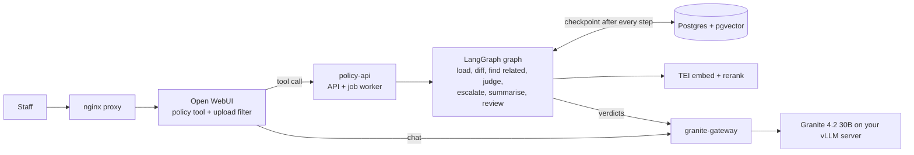
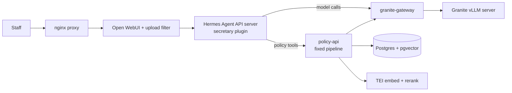
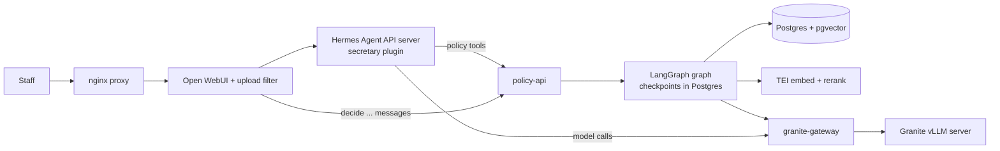

# secretary-keeper

Ask **"Which of our Safety policies are affected by the change to POL-007?"** and get back a
plain-language answer, a comparison table, and an Excel workbook with the evidence for every policy.

> **You are on the `langgraph` branch.** In this version, people chat with Granite in Open WebUI, and
> Granite calls a policy tool. Each check runs as a LangGraph graph inside policy-api, with its state
> saved to Postgres after every step. A crash resumes where it stopped. With `REVIEW_GATE=1`, a check
> with "maybe" sections pauses until a person decides them in chat. The other versions are described
> under [Three versions](#three-versions). The full design is in [docs/architecture.md](docs/architecture.md).

It runs on your own hardware with US-developed models. Policy text never leaves your network: the
backend is sealed, and the only way out is one gateway to your own Granite server.



How it works in one paragraph: Open WebUI sends each chat to Granite, which picks a tool. The policy
tool asks policy-api to run the check, and policy-api queues it as a job. A worker runs the job as a
graph of seven steps. Granite judges one pair of sections at a time, and code makes every other
decision and builds every number and file. Postgres keeps a checkpoint after each step, so a restart
carries on from the last finished one. With the review gate on, the check stops before the final answer
and waits for the person to type `decide <check number> <section> <yes|no>, ...`. The upload filter
records that under their own name. The model has no tool for deciding.

The main model, IBM Granite 4.2 30B, already runs on your own vLLM server. The stack does not start
it. Everything reaches it through `granite-gateway`, the one way out of the sealed backend network.
The gateway passes on chat and model-list calls only, adds the API key itself, and checks the
server's certificate. Inkling-Small ("unsure" cases) and the other extra models are optional and run
locally. See [docs/setup.md](docs/setup.md#granite-server-requirements).

## Three versions

This repo has four branches; you are on `langgraph`. `main` is the v0.1 baseline. The other three build on one shared base
(the trimmed chat screen and the Granite gateway) and differ in who drives a check.

| Branch | In one line |
|---|---|
| `main` | v0.1 baseline. An Open WebUI tool calls policy-api, which runs a fixed pipeline. |
| `langgraph` | No Hermes. Open WebUI plus the policy tool. Each check runs as a LangGraph graph with Postgres checkpoints, so a crash resumes where it stopped. With `REVIEW_GATE` on, the check pauses and the person decides the "maybe" sections in chat. |
| `hermes` | Open WebUI talks to the Hermes Agent API server, which uses Granite. Hermes has a `secretary` plugin with policy tools, including database search (`GET /search`) and policy text (`GET /policies/{id}/text`). It has no web, files, terminal or memory, and no MCP. |
| `hermes-langgraph` | Hermes in front, LangGraph running each check. The person records review decisions by typing a message that starts with `decide <check> <section> <yes\|no>, ...`. The Open WebUI upload filter parses it and records it under the user's real name. The model has no decide tool. |

### `hermes`



### `hermes-langgraph`



### Comparing them

| | `main` | `langgraph` | `hermes` | `hermes-langgraph` |
|---|---|---|---|---|
| Who decides which tool to call | Granite, through Open WebUI | Granite, through Open WebUI | Hermes (with Granite) | Hermes (with Granite) |
| How a check runs | Fixed pipeline in policy-api | LangGraph graph | Fixed pipeline in policy-api | LangGraph graph |
| Crash recovery | Job queue restarts the job | Resumes from the last checkpoint | Job queue restarts the job | Resumes from the last checkpoint |
| Review pause | No (review happens afterwards) | Optional `REVIEW_GATE`: the person types `decide <check> <section> <yes\|no>, ...` in chat; the upload filter records it | No | Optional pause; the person types `decide <check> <section> <yes\|no>, ...` and the upload filter records it |
| Extra containers | None | None (graph runs inside policy-api) | Hermes | Hermes |
| Granite context needed | 32K or more | 32K or more | 64K or more (Hermes refuses less); 128K recommended | 64K or more; 128K recommended |

In every version, code makes the impact decisions and builds the numbers and the Excel file. The
chat model only passes the question in and the answer back. Required Granite server settings are in
[docs/setup.md](docs/setup.md#granite-server-requirements).

## Try it in five minutes (no GPUs)

Demo mode uses the sample policies in `samples/` and simple stand-in models. It shows the flow
and the outputs. **It is not for real decisions.**

```bash
cd policy_api
python3 -m venv .venv && .venv/bin/pip install -r requirements-dev.txt
.venv/bin/python -m app.demo ../samples --out demo.xlsx    # prints the chat answer, writes the Excel file
.venv/bin/python -m pytest -q                               # runs the tests
```

## Documentation

| If you want to… | Read |
|---|---|
| Read everything as one PDF, with diagrams | [docs/pdf/handbook.pdf](docs/pdf/handbook.pdf) |
| Understand how it works and why it's built this way | [docs/architecture.md](docs/architecture.md) |
| Install it (and what your Granite server needs) | [docs/setup.md](docs/setup.md) |
| Choose which GPUs each model uses | `python3 scripts/setup_gpus.py` ([setup.md step 3](docs/setup.md)) |
| Ask questions and read the results (staff) | [docs/how-to.md](docs/how-to.md) |
| Add policies, groups or models (admins) | [docs/how-to.md](docs/how-to.md#for-admins) |
| Run it day to day, upgrade it, fix problems | [docs/operations.md](docs/operations.md) |
| Run and understand the tests | [docs/testing.md](docs/testing.md) |
| Measure whether it finds the right policies | [docs/evaluation.md](docs/evaluation.md) |
| Keep data contained and the system safe | [docs/security.md](docs/security.md) |

## What's in the repo

| Path | What it is |
|---|---|
| `compose.yaml`, `.env.example` | The whole stack: Granite gateway, optional local models (vLLM), TEI, Postgres, policy-api, Open WebUI, proxy |
| `policy_api/` | The analysis pipeline and HTTP API (Python, FastAPI) |
| `openwebui/` | The Open WebUI tool, upload filter, custom CSS and the system prompt for the chat model |
| `gateway/` | nginx config for `granite-gateway`, the only way out of the backend network |
| `proxy/nginx.conf` | The only service users reach |
| `db/init.sql` | Database schema, including the audit trail |
| `scripts/` | Network-containment check and model hash check |
| `samples/` | Sample policies and a sample changed policy |
| `eval/` | Evaluation cases (real ones stay out of git) |
| `models/` | Model weights go here (not in git); see `models/README.md` |

## Status

Version 0.1. Built and tested: the pipeline, the API, the Excel output, the Postgres store, the Open
WebUI tool's logic, the Docker network containment, and the proxy. These were tested with stand-in
models only. Before real use, run the full stack on the GPU server with the real models and complete
an evaluation against past policy changes ([docs/evaluation.md](docs/evaluation.md)).

Also built: a job queue and LangGraph checkpoints that keep checks alive across restarts, an optional pause for people to decide "maybe" sections in chat (`REVIEW_GATE`), PDF, Word, Excel and chart output
from the chat, a review queue (Argilla) where staff confirm or correct verdicts, and LoRA fine-tuning
from those reviews. See [docs/review-and-training.md](docs/review-and-training.md) and
[docs/architecture.md](docs/architecture.md#roadmap).

## License

MIT. See [LICENSE](LICENSE).
